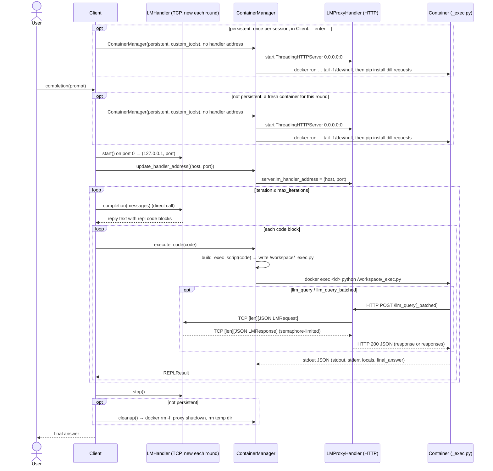

# DockerREPL — MVP Architecture

## 1. Goal

A client sends a prompt to a selected language model (LM), mocked for now. If
the LM's reply contains ```` ```repl ```` code blocks, the client extracts them
and runs them in a Docker container (`python:3.11-slim`, with `dill` and
`requests` installed). Code in the container can call the LM through
`llm_query()` and `llm_query_batched()`, and can call `SHOW_VARS()` to list
the variables the REPL currently holds. Those calls go over HTTP to an
**LMProxyHandler** on the host. The proxy forwards them to the **LMHandler**,
a multithreaded TCP server, using length-prefixed JSON. The client can also
give the container `custom_tools`. In **persistent** mode the container and
its variables, including saved LM responses, carry over from one prompt to
the next.

### Terms

| Term | Meaning |
|---|---|
| **session** | The lifetime of one container, together with its proxy and `state.dill`. |
| **round** | One `Client.completion(prompt)` call. Each round gets a **new LMHandler**. |
| **iteration** | One LM reply inside a round, plus running its code blocks. A round has at most `max_iterations` iterations. |

## 2. Component diagram

```
 ┌─────────────────────────────────── HOST ───────────────────────────────────────┐
 │  Client process                                                                │
 │                                                                                │
 │  User ─prompt─▶ ┌──────────────┐ completion(messages)  ┌────────────────────┐  │
 │                 │    Client    │──────── direct call ─▶│ LMHandler          │  │
 │  ◀─final answer─│ (round loop) │◀──────── text ────────│ ThreadingTCPServer │  │
 │                 └──┬────────┬──┘                       │ 127.0.0.1:<port 0> │  │
 │     find_code_blocks│        │ new LMHandler per round  │  └ MockLM          │  │
 │                    ▼        ▼ update_handler_address() └─────────▲──────────┘  │
 │      ┌──────────────────────────────────────────┐                │             │
 │      │ ContainerManager  (context manager)      │                │ TCP: 4-byte │
 │      │  container_id, persistent, custom_tools  │                │ big-endian  │
 │      │  execute_code(code) -> REPLResult        │                │ len + JSON  │
 │      │  ┌──────────────────────────────────────┐│                │ (new conn   │
 │      │  │ LMProxyServer  ThreadingHTTPServer   ││────────────────┘  per call)  │
 │      │  │ 0.0.0.0:<port 0>  handler class =    ││                              │
 │      │  │ LMProxyHandler; reads                ││                              │
 │      │  │ server.lm_handler_address (live)     ││                              │
 │      │  └──────────────────▲───────────────────┘│                              │
 │      └───────┬─────────────┼────────────────────┘                              │
 │  docker exec │ <id> python │ HTTP POST /llm_query, /llm_query_batched          │
 │  _exec.py    │ stdout: JSON│ via host.docker.internal:<proxy_port>             │
 │              ▼             │                                                   │
 │  ┌──────── container python:3.11-slim (+dill, requests) ─────────────────────┐ │
 │  │  PID 1: tail -f /dev/null                                                 │ │
 │  │  /workspace/_exec.py     rebuilt by the host for every code block,        │ │
 │  │     code str base64-embedded; one short-lived python process per exec     │ │
 │  │     load state.dill → add helpers (§3.5), answer, custom tools            │ │
 │  │     → exec(code) → save state.dill → print one JSON line                  │ │
 │  │  /workspace/state.dill   variables (bind mount from a host temp dir)      │ │
 │  └───────────────────────────────────────────────────────────────────────────┘ │
 └────────────────────────────────────────────────────────────────────────────────┘
```

The four links:

| Link | Transport | Why |
|---|---|---|
| Client → LMHandler | direct method call, same process | `lm_handler.completion(messages)`. The Client doesn't need a socket to reach its own handler. |
| Client → container | `execute_code(code: str)` → host writes `_exec.py` to the shared workspace → `docker exec <id> python /workspace/_exec.py` → JSON on stdout | The ContainerManager holds `container_id`. No port is published on the container. |
| container → LMProxyHandler | HTTP + JSON | The container can only use `requests`. The proxy is reached at `host.docker.internal`. |
| LMProxyHandler → LMHandler | TCP, 4-byte big-endian length + UTF-8 JSON | Simple framing, no HTTP overhead. LMHandler stays on loopback. |

## 3. Components and their parameters

Only the parameters listed here are in the MVP.

### 3.1 `comms.py`

```python
import socket
from dataclasses import dataclass, field
from typing import Any

DEFAULT_TIMEOUT: int = 300                     # seconds; shared by comms and BaseLM

@dataclass
class LMRequest:                               # proxy → handler
    prompt: str | dict[str, Any] | None = None             # single
    prompts: list[str | dict[str, Any]] | None = None      # batched
    model: str | None = None

    @property
    def is_batched(self) -> bool: ...          # prompts is a non-empty list
    def to_dict(self) -> dict[str, Any]: ...
    @classmethod
    def from_dict(cls, data: dict[str, Any]) -> "LMRequest": ...

@dataclass
class LMResponse:                              # handler → proxy
    error: str | None = None                   # set → this request (or prompt) failed
    response: str | None = None                # single
    responses: list["LMResponse"] | None = None   # batched, same order as prompts

    @property
    def success(self) -> bool: ...             # error is None
    def to_dict(self) -> dict[str, Any]: ...
    @classmethod
    def from_dict(cls, data: dict[str, Any]) -> "LMResponse": ...

def socket_send(sock: socket.socket, data: dict) -> None:
    """4-byte big-endian length of the UTF-8 JSON payload, then the payload."""
def socket_recv(sock: socket.socket) -> dict:
    """Read the 4-byte length, then loop until that many bytes have arrived."""
def socket_request(address: tuple[str, int], data: dict,
                   timeout: int = DEFAULT_TIMEOUT) -> dict:
    """Open a new TCP connection, send one message, read one reply, close."""
def send_lm_request(address: tuple[str, int], request: LMRequest,
                    timeout: int = DEFAULT_TIMEOUT) -> LMResponse:
    """Never raises: a connection or decode failure becomes LMResponse(error=...)."""
def send_lm_request_batched(address: tuple[str, int],
                            prompts: list[str | dict[str, Any]],
                            model: str | None = None,
                            timeout: int = DEFAULT_TIMEOUT) -> list[LMResponse]:
    """One framed request for all prompts. Returns one LMResponse per prompt,
    in order. If the whole call fails, every slot gets the same error."""
```

* **`socket_recv` reads in a loop.** `recv` can return fewer bytes than asked
  for, so it keeps reading until it has all `length` bytes. If the connection
  closes before the 4-byte length arrives, it returns `{}`. If it closes partway
  through the payload, it raises `ConnectionError`.
* **One batched request, a list back.** On the wire, a batched reply is one
  `LMResponse` whose `responses` holds one `LMResponse` per prompt.
  `send_lm_request_batched` unpacks that into the `list[LMResponse]` it returns.
* **Prompt types.** `LMRequest.prompt` is `str | dict[str, Any]`. Code in the
  container sends a `str`, or a `dict` for a structured prompt. The Client's
  whole conversation is a `list[dict[str, Any]]` of messages. It never crosses
  the socket, because the Client calls `LMHandler.completion()` directly (§3.2).

### 3.2 `LMHandler`

```python
class LMHandler:
    def __init__(self, client: BaseLM, host: str = "127.0.0.1", port: int = 0,
                 max_concurrent: int = 8): ...
    client: BaseLM
    host: str
    max_concurrent: int
    _slots: threading.BoundedSemaphore        # max_concurrent LM calls in flight
    _server: ThreadingTCPServer | None
    _thread: threading.Thread | None
    @property
    def address(self) -> tuple[str, int]: ... # real port, read after start()
    def start(self) -> tuple[str, int]: ...
    def stop(self) -> None: ...
    def completion(self, prompt: str | dict[str, Any] | list[dict[str, Any]],
                   model: str | None = None) -> str: ...   # direct call used by Client
    def __enter__(self) -> "LMHandler": ...   # start()
    def __exit__(self, *exc: object) -> None: ...   # stop()
```

* The server is `ThreadingTCPServer` with `daemon_threads = True` and
  `allow_reuse_address = True`. Its request handler is a
  `StreamRequestHandler` that does `socket_recv`, then dispatches, then
  `socket_send`. Each connection gets its own thread.
* `serve_forever()` runs in a daemon `Thread`.
* `port=0` lets the OS pick a free port, so a new handler for each round never
  clashes with an earlier one.
* **Batched requests:** one request carries all the prompts. The handler runs
  them concurrently with `ThreadPoolExecutor.map`, which returns results in
  input order. A failure on one prompt is caught and becomes that prompt's
  error; the other prompts still succeed. There is no shared results list, so
  no lock is needed (§6).
* **Concurrency cap:** every call to `client.completion()` first takes a slot
  from `_slots`, a `BoundedSemaphore(max_concurrent)`, and gives it back
  afterwards. That includes direct calls, single `llm_query` calls, and each
  prompt of a batch. The semaphore covers the whole handler, so the limit
  holds even when several batches and single calls arrive at once.

### 3.3 `BaseLM` / `MockLM`

```python
class BaseLM(ABC):
    def __init__(self,
                 model_name: str,
                 timeout: float = DEFAULT_TIMEOUT,
                 sampling_args: dict[str, Any] | None = None,
                 **kwargs: Any): ...
    model_name: str
    timeout: float                    # per-call limit for the backend request
    sampling_args: dict[str, Any]     # e.g. {"temperature": 0.2, "max_tokens": 1024}; {} if None
    kwargs: dict[str, Any]            # backend-specific options (api_key, base_url, ...)

    @abstractmethod
    def completion(self, prompt: str | dict[str, Any] | list[dict[str, Any]]) -> str: ...

class MockLM(BaseLM):
    def __init__(self,
                 scripted: list[str] | None = None,
                 model_name: str = "mock",
                 **kwargs: Any): ...           # passed on to BaseLM
    scripted: list[str]
    _cursor: int
    _lock: threading.Lock
```

* **Root prompts** (a list of messages from the Client) get the next reply from
  `scripted`, which can contain ```` ```repl ```` blocks. When the list runs
  out, MockLM returns a fixed final-answer block. The position in the list is
  guarded by a lock.
* **Sub-queries** (a `str` from `llm_query`) get `f"Mock: {prompt[:50]}"`.
* **No token cost.** MockLM accepts `timeout` and `sampling_args` but ignores
  them. A real client only needs to implement `completion()`, passing
  `sampling_args` and `timeout` to its API.

### 3.4 `ContainerManager` + `LMProxyHandler`

```python
class ContainerManager:
    def __init__(self,
                 image: str = "python:3.11-slim",
                 lm_handler_address: tuple[str, int] | None = None,   # usually set later
                 persistent: bool = False,
                 custom_tools: dict[str, Any] | None = None,
                 exec_timeout: int = 60): ...
    image: str
    persistent: bool
    custom_tools: dict[str, Any]
    exec_timeout: int
    container_id: str | None
    temp_dir: str                                 # host side of /workspace
    proxy_server: ThreadingHTTPServer | None
    proxy_thread: threading.Thread | None
    proxy_port: int
    def setup(self) -> None: ...                  # called by __init__
    def execute_code(self, code: str) -> REPLResult: ...
    def update_handler_address(self, address: tuple[str, int]) -> None: ...
    def cleanup(self) -> None: ...                # idempotent
    def __enter__(self) -> "ContainerManager": ...
    def __exit__(self, *exc: object) -> None: ... # cleanup()
```

**`setup()`** does the following in order:
1. Calls `validate_custom_tools()`.
2. Makes a host temp dir to use as the workspace.
3. Starts `LMProxyServer = ThreadingHTTPServer(("0.0.0.0", 0), LMProxyHandler)`
   with `daemon_threads = True`, and sets
   `server.lm_handler_address = lm_handler_address`. That is usually `None`
   at this point; the Client sets the address each round (§3.6).
4. Runs `docker run -d --rm -v <tmp>:/workspace --add-host host.docker.internal:host-gateway <image> tail -f /dev/null`
   and saves the `container_id` it prints.
5. Runs `docker exec <id> pip install -q dill requests` (the default install),
   then checks that `import requests` works.

**`execute_code(code: str)`** takes the code block exactly as the LM wrote
it, as found by `find_code_blocks`. It:
1. Builds a complete script with `_build_exec_script(code, proxy_port, custom_tools)`
   (§3.5). The code is embedded **base64-encoded**, so quotes, backslashes and
   triple quotes in LM-written code can't break the script.
2. Writes that script to `<tmp>/_exec.py`, which the container sees as
   `/workspace/_exec.py`.
3. Runs `docker exec <id> timeout <exec_timeout> python /workspace/_exec.py`.
4. Parses the last line of stdout as JSON and returns:

```python
@dataclass
class REPLResult:
    stdout: str
    stderr: str
    locals: dict[str, str]        # name -> repr(value)
    final_answer: str | None      # set when the code sets answer["ready"] = True
    execution_time: float
```

**`update_handler_address(address)`** sets `proxy_server.lm_handler_address = address`.
It also runs `answer = {"content": "", "ready": False}` in the container, so
an old `ready=True` from the previous round doesn't end the new round at
once. The container never sees the change of address.

**`LMProxyHandler(BaseHTTPRequestHandler)`** has two routes, and every reply is
JSON. Each route reads `self.server.lm_handler_address` on every request,
which is what lets the address change from round to round.
* `POST /llm_query` with `{"prompt", "model"}` makes one framed TCP request to
  LMHandler and returns `{"response"}` or `{"error"}`.
* `POST /llm_query_batched` with `{"prompts", "model"}` makes one framed TCP
  request carrying all the prompts and returns `{"responses": [...]}`. A
  failed prompt comes back as `"Error: ..."` in its place in the list.

It returns `{"error": "No LM handler configured"}` if no address is set, and
`500 {"error"}` if the handler itself raises. It never drops a connection
without replying.

**`custom_tools`** format:

```python
custom_tools = {
    "triple": "def triple(x):\n    return x * 3",               # code string → exec'd
    "CONST":  7,                                                # JSON value → variable
    "LOOKUP": {"tool": {"a": 1}, "description": "a dict"},      # value + description
}
```

* **Code strings** (starting with `def`, `class` or `lambda`, or containing a
  newline) are run with `exec()` in the container's namespace.
* **JSON-serializable values** are loaded as variables.
* **Host callables are rejected with `ValueError`.** A Python function can't
  cross into the container, so pass it as a code string instead. Failing
  early makes the mistake obvious.
* **Reserved names** can't be used: `llm_query`, `llm_query_batched`,
  `SHOW_VARS` and `answer`.
* **Tools are put into every generated script** by `_build_custom_tools_code()`,
  so user code that overwrites one doesn't break later runs.
* **Descriptions go into the system prompt** through `format_tools_for_prompt()`.

### 3.5 `_build_exec_script()` → `_exec.py` (one process per exec)

On the host, `_build_exec_script(code, proxy_port, custom_tools) -> str`
fills in a template. The generated `_exec.py` then runs in the container:

```python
PROXY = "http://host.docker.internal:<proxy_port>"          # filled in by the host
def llm_query(prompt, model=None) -> str                    # POST /llm_query
def llm_query_batched(prompts, model=None) -> list[str]     # POST /llm_query_batched
def SHOW_VARS() -> str                                      # list REPL variables, no network
# custom tools: code strings pasted in, JSON values loaded with json.loads
code = base64.b64decode("<code_b64>").decode()
```

* `llm_query` and `llm_query_batched` return `"Error: ..."` strings instead of
  raising, so a failed LM call doesn't crash the user's code.
* `SHOW_VARS()` returns `"Available variables: {name: type_name, ...}"` for
  every variable whose name doesn't start with `_`, leaving out `answer`. If
  there are none, it says so. The LM can use it to look inside the container
  before writing more code, for example `print(SHOW_VARS())`. It runs entirely
  inside the container and makes no LM call.
* Steps for each exec:
  1. Decode `code` from base64.
  2. Load `state.dill`. If there is no `answer`, set
     `answer = {"content": "", "ready": False}`.
  3. Build the namespace from the helpers plus the custom tools.
  4. `exec(code)`, with stdout and stderr captured to buffers.
  5. Save every variable that dill can pickle and whose name doesn't start
     with `_`.
  6. Print one JSON line: `{stdout, stderr, locals, final_answer}`.
* **Saved LM responses** are just variables. For example, `r = llm_query(...)`
  is still there in the next exec, and in the next round if `persistent=True`.

### 3.6 `Client`

```python
class Client:
    def __init__(self, lm: BaseLM,
                 persistent: bool = False,
                 custom_tools: dict[str, Any] | None = None,
                 max_iterations: int = 10,
                 image: str = "python:3.11-slim"): ...
    lm: BaseLM
    persistent: bool
    custom_tools: dict[str, Any] | None
    max_iterations: int
    image: str
    _env: ContainerManager | None                  # the session's container (persistent)
    def completion(self, prompt: str) -> str: ...  # one round
    def close(self) -> None: ...                   # cleans up a persistent container
    def __enter__(self) -> "Client": ...           # persistent → start the container now
    def __exit__(self, *exc: object) -> None: ...  # close()
```

**Order: container first, then a new LMHandler for each round.** The container
belongs to the session and the LMHandler belongs to the round. So the
container is set up before any handler exists (with no handler address yet),
and each round starts its own handler and points the proxy at it.

```python
def __enter__(self):
    if self.persistent:
        self._env = self._new_env()                    # set up once for the session
    return self

def _new_env(self) -> ContainerManager:
    return ContainerManager(self.image, persistent=self.persistent,
                            custom_tools=self.custom_tools)   # no handler address yet

def completion(self, prompt: str) -> str:
    # 1. Container: the session's one, or a fresh one for this round.
    if self.persistent:
        if self._env is None:                          # used without `with`
            self._env = self._new_env()
        env = self._env
    else:
        env = self._new_env()
    try:
        # 2. A new LMHandler for this round; point the proxy at it.
        with LMHandler(self.lm) as lm_handler:
            env.update_handler_address(lm_handler.address)
            # 3. Iterations.
            messages = build_system_prompt(self.custom_tools) + [user(prompt)]
            for _ in range(self.max_iterations):
                reply = lm_handler.completion(messages)
                messages.append(assistant(reply))
                for code in find_code_blocks(reply):        # r"```repl\s*\n(.*?)\n```"
                    result = env.execute_code(code)
                    if result.final_answer is not None:
                        return result.final_answer
                    messages.append(user(format_result(code, result)))
            return lm_handler.completion(messages + [ask_for_final_answer()])
    finally:
        if not self.persistent:
            env.cleanup()
```

* Both modes use the same order: container, then handler, then iterations.
  `persistent` only decides whether the container is reused and when it is
  removed.
* **Clean shutdown order.** The LMHandler stops when its `with` block ends.
  Only after that does `finally` remove a non-persistent container. A
  persistent container and its proxy stay up until `close()`.
* **No address before the first round.** Between rounds, and before the first
  one, the proxy has no live handler. Nothing runs in the container then, so
  no request can arrive. If one did, the proxy would answer
  `{"error": "No LM handler configured"}`.

`build_system_prompt()` tells the LM to write ```` ```repl ```` blocks, lists
`llm_query`, `llm_query_batched` and `SHOW_VARS`, explains `answer["ready"]`,
and adds the custom tool descriptions.

## 4. Sequence (session setup, then one round)



## 5. Persistent vs. non-persistent

**Within one round, variables always carry
over** between code blocks and iterations through `state.dill`, because a
multi-step answer depends on that. The `persistent` flag only decides whether
the session lasts beyond the round.

| | `persistent=False` | `persistent=True` |
|---|---|---|
| Container + proxy | made at the start of the round, removed at the end | made once in `Client.__enter__`, reused until `Client.close()` |
| LMHandler | new each round, started after the container; `update_handler_address()` points the proxy at it | same |
| Variables / saved LM responses | gone after the round | carried into later rounds |
| `answer` | starts fresh | reset by `update_handler_address()` at the start of each round |

## 6. Threading and concurrency

* **Both servers are multithreaded.** LMHandler is a `ThreadingTCPServer` and
  LMProxyServer is a `ThreadingHTTPServer`. Each one runs `serve_forever()` in
  a daemon thread, handles every connection in its own thread, and sets
  `daemon_threads = True`.
* **No deadlock.** The Client's main thread waits on `docker exec` while the
  container calls back into both servers, and those run on their own threads.
* **Concurrency in two places.** User code can run `llm_query` from several
  threads at once, and each call gets its own proxy and handler threads. A
  single `llm_query_batched` call fans out inside LMHandler through its thread
  pool.
* **Batched results need no lock.** `ThreadPoolExecutor.map` collects each
  prompt's result and returns them in input order, so worker threads never
  write to a shared list. (If results were written into a shared list by
  index, each thread would write a different slot. That is also safe in
  CPython, but `map` makes it clear.) A semaphore isn't the tool for guarding
  shared data anyway: that is what a `Lock` is for.
* **A semaphore caps how many LM calls run at once.** `LMHandler._slots` is a
  `BoundedSemaphore(max_concurrent)`, and every `client.completion()` call
  holds one slot while it runs. A thread pool only limits its own batch, so
  two batches plus a few single calls could otherwise exceed the limit. With a
  real API, the cap keeps you under its rate limits. With the mock it changes
  nothing, but the code path is the same.
* **No late requests.** Shutting down the old LMHandler at the end of a round
  is safe. `docker exec` only returns once the `_exec.py` process has exited, so
  no `llm_query` from that round can still be in flight.
* **Shared state that does need a `Lock`:** the MockLM position in its script
  (`_cursor`). The proxy shares no `requests.Session`.

## 7. Networking (Linux)

* **The proxy binds to `0.0.0.0`.** On native Linux, `host.docker.internal`
  (set by `--add-host … host-gateway`) points to the bridge gateway, such as
  `172.17.0.1`. A server bound to `127.0.0.1` can't be reached from there.
* **LMHandler binds to `127.0.0.1`.** Only the proxy, on the same host, talks
  to it.
* **No container ports are published.** All code execution goes through
  `docker exec`.

## 8. Layout

```
dockerrepl/
  comms.py               # LMRequest/LMResponse, socket_send/recv/request, send_lm_request[_batched]
  lm_handler.py          # LMHandler (ThreadingTCPServer)
  clients/
    base_lm.py           # BaseLM
    mock_lm.py           # MockLM
  environments/
    tools.py             # validate_custom_tools, format_tools_for_prompt, RESERVED_TOOL_NAMES
    container_manager.py # ContainerManager, LMProxyHandler, REPLResult
    exec_script.py       # _build_exec_script, _build_custom_tools_code (template for _exec.py)
  client.py              # Client, find_code_blocks, prompt helpers
examples/
  docker_repl_example.py # exec, llm_query, llm_query_batched, SHOW_VARS, tools, persistent
tests/
  test_comms.py          # framing round-trip, partial reads, closed connection
  test_lm_handler.py     # single + batched over real sockets, no Docker
  test_proxy.py          # proxy ↔ handler over loopback, no Docker
  test_exec_script.py    # generated _exec.py run as a local subprocess, no Docker
  test_e2e.py            # Client + MockLM + Docker (skipped if Docker is missing)
```

## 9. Scope

In the MVP:
* one LM client (`MockLM`), a new LMHandler for each round
* `llm_query`, `llm_query_batched`, `SHOW_VARS`, `custom_tools`,
  `answer["ready"]`
* persistent and non-persistent sessions, a time limit on each exec

Left out for now:
* recursive sub-calls (an LM call that starts its own REPL loop)
* several LM backends and routing between them
* versioned context/history variables across rounds, and history compaction
* usage, token and budget tracking; structured logging

## 10. Build order

1. `comms.py` and its tests.
2. `BaseLM`, `MockLM` and `LMHandler`, tested over sockets.
3. `LMProxyHandler` and `tools.py`, tested against a real LMHandler with no
   Docker.
4. `exec_script.py`: build a script and run it locally as a subprocess,
   pointed at a local proxy.
5. `ContainerManager`, checked with Docker.
6. `Client` and `examples/docker_repl_example.py`, then the end-to-end test.
