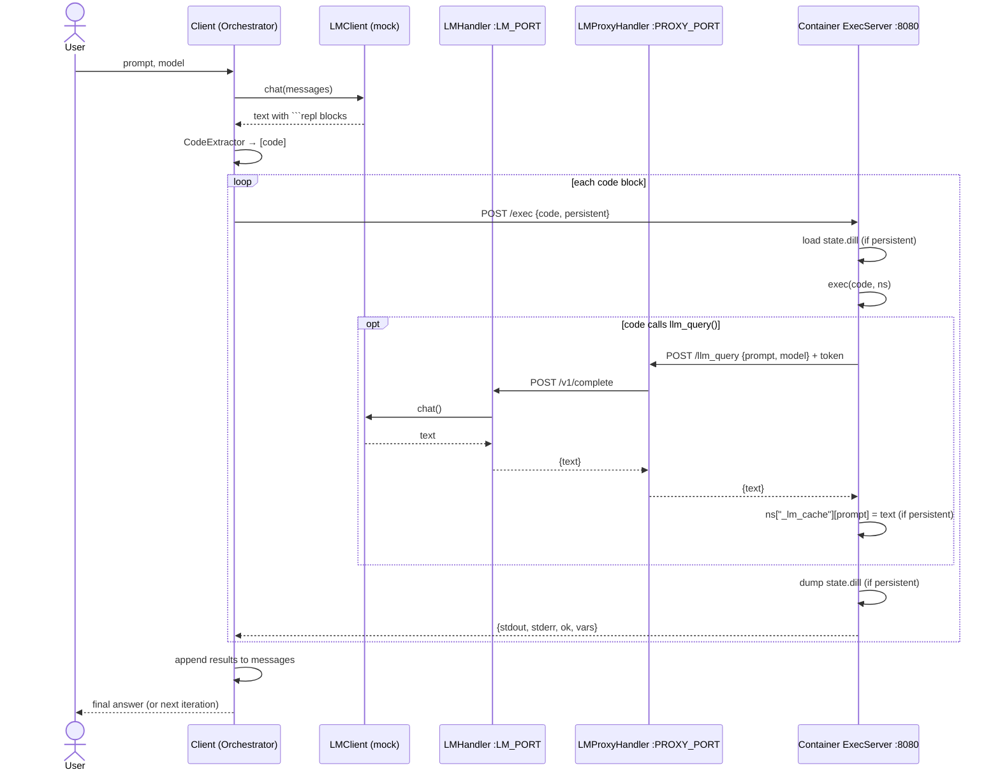

# DockerREPL — MVP Architecture

## 1. Goal

A client sends a prompt to a selected language model (LM). If the LM's reply
contains code blocks fenced as ```` ```repl ```` , the client extracts them and
runs them in a Docker container (`python:3.11-slim` + `dill` + `requests`) on
the same machine. Code running in the container may itself call the LM; those
calls go out over HTTP through an **LMProxyHandler** to the client's
**LMHandler** (a threading HTTP server). In **persistent** mode the container
keeps its variables, including saved LM responses, from one round to the next.

All components are Python. Every hop is HTTP + JSON.

## 2. Component diagram

```
 ┌──────────────────────────────── HOST MACHINE ─────────────────────────────────┐
 │                                                                                │
 │  ┌──────────────────────────── Client process ───────────────────────────┐    │
 │  │                                                                        │    │
 │  │   User ──prompt──▶ ┌───────────────┐   chat()   ┌──────────────────┐   │    │
 │  │                    │  Orchestrator │──────────▶ │ LMClient (iface) │   │    │
 │  │   ◀──final answer──│  (Client)     │◀────────── │  └ MockLMClient  │   │    │
 │  │                    └──────┬────────┘   text     │  └ (OpenAI/…)    │   │    │
 │  │                           │                     └────────▲─────────┘   │    │
 │  │              text         ▼                              │ chat()      │    │
 │  │                    ┌───────────────┐            ┌────────┴─────────┐   │    │
 │  │                    │ CodeExtractor │            │    LMHandler     │   │    │
 │  │                    │ (```repl …```)│            │ ThreadingHTTP-   │   │    │
 │  │                    └──────┬────────┘            │ Server (thread)  │   │    │
 │  │                 [code str]│                     │ 127.0.0.1:LM_PORT│   │    │
 │  │                           ▼                     └────────▲─────────┘   │    │
 │  │                    ┌───────────────┐                     │             │    │
 │  │                    │ContainerMgr / │                     │ HTTP POST   │    │
 │  │                    │ REPLEnv       │                     │ /v1/complete│    │
 │  │                    └──────┬────────┘            ┌────────┴─────────┐   │    │
 │  │                           │                     │  LMProxyHandler  │   │    │
 │  │                           │                     │ ThreadingHTTP-   │   │    │
 │  │                           │                     │ Server (thread)  │   │    │
 │  │                           │                     │ 0.0.0.0:PROXY_PORT   │    │
 │  │                           │                     └────────▲─────────┘   │    │
 │  └───────────────────────────┼──────────────────────────────┼─────────────┘    │
 │       HTTP POST /exec        │                              │ HTTP POST        │
 │       127.0.0.1:EXEC_PORT    │                              │ /llm_query       │
 │                              ▼                              │ host.docker.internal
 │  ┌───────────────────── Docker container (python:3.11-slim, dill, requests) ─┐ │
 │  │                    ┌───────────────┐   exec(code, ns)  ┌───────────────┐   │ │
 │  │                    │  ExecServer   │──────────────────▶│ user code     │   │ │
 │  │                    │  :8080        │◀──stdout/stderr───│ llm_query(...)│───┘ │
 │  │                    └──────┬────────┘                   └───────────────┘     │
 │  │                           │ persistent? dill.dump / dill.load               │
 │  │                           ▼                                                 │
 │  │                 /workspace/state.dill  (volume)                             │
 │  └─────────────────────────────────────────────────────────────────────────────┘
 └────────────────────────────────────────────────────────────────────────────────┘
```

## 3. Components

| Component | Runs in | Responsibility |
|---|---|---|
| **Orchestrator (Client)** | host | Owns the session loop: prompt → LM → extract → execute → feed results back → repeat until a final answer or `max_iterations`. Starts/stops the two HTTP servers and the container. |
| **LMClient** | host | Abstract `chat(messages, model) -> str`. `MockLMClient` returns scripted/templated replies (including ```` ```repl ```` blocks) so the MVP costs no tokens. Real clients can be added later. |
| **CodeExtractor** | host | Regex over the LM text, returns `list[str]` of code blocks. Accepts ```` ```repl ```` (case-insensitive) and, optionally, `'''REPL ... '''`. |
| **LMHandler** | host, thread | `ThreadingHTTPServer` on `127.0.0.1:LM_PORT`. `POST /v1/complete` → calls `LMClient.chat` → returns JSON. Loopback only; never exposed to the container directly. |
| **LMProxyHandler** | host, thread | `ThreadingHTTPServer` reachable from the container (`host.docker.internal:PROXY_PORT`). Validates a per-session token, enforces limits (max calls, max prompt size, timeout), logs, then forwards to LMHandler. The single egress point from the sandbox to the LM. |
| **ContainerManager / REPLEnv** | host | Builds/starts the image (`docker` CLI via `subprocess`, or the `docker` SDK), publishes the exec port on `127.0.0.1`, mounts the workspace volume, passes env vars (`LM_PROXY_URL`, `SESSION_TOKEN`). Sends `POST /exec`. Tears down. |
| **ExecServer** | container | Small `http.server` app. `POST /exec` runs code with `exec()` in a namespace, captures stdout/stderr, returns them as JSON. Puts `llm_query()` into the namespace. Persistent mode: `dill.load` before, `dill.dump` after. |
| **llm_query()** | container | Helper the user code calls: `requests.post(LM_PROXY_URL + "/llm_query", json=..., headers={"X-Session-Token": ...})`. In persistent mode it also writes each reply into `_lm_cache` in the namespace, so later rounds can reuse it. |

## 4. Why a proxy *and* a handler?

* **Isolation:** LMHandler stays on loopback and holds the API keys. The
  container can only reach the proxy, which exposes one narrow endpoint.
* **Policy:** budgets, recursion depth, rate limits and auth all live in one
  place (the proxy), so LMHandler stays a plain "call the model" service.
* **Swap-ability:** the LM side can move to another machine later without
  changing anything in the container.

## 5. Sequence (one round)



**Avoiding deadlock:** while `POST /exec` blocks the orchestrator thread, the
container calls back into the host. That is why LMHandler and LMProxyHandler
each run a `ThreadingHTTPServer` in its own daemon thread, started before the
first `/exec`.

## 6. HTTP contracts (JSON)

| Endpoint | Request | Response |
|---|---|---|
| `POST /exec` (ExecServer) | `{"code": str, "persistent": bool, "timeout": float}` | `{"ok": bool, "stdout": str, "stderr": str, "error": str\|null, "variables": [str], "duration_s": float}` |
| `POST /reset` (ExecServer) | `{}` | `{"ok": true}`. Clears the namespace and deletes `state.dill`. |
| `GET /health` (ExecServer) | — | `{"ok": true}` |
| `POST /llm_query` (LMProxyHandler) | header `X-Session-Token`; `{"prompt": str, "model": str\|null}` | `{"ok": bool, "text": str, "error": str\|null}` |
| `POST /v1/complete` (LMHandler) | `{"messages": [{"role","content"}], "model": str}` | `{"ok": bool, "text": str, "usage": {...}}` |

## 7. Persistent vs. non-persistent

| | Non-persistent | Persistent |
|---|---|---|
| Namespace per `/exec` | new, empty | loaded from `state.dill`, saved back afterwards |
| `_lm_cache` | gone after the call | kept; `llm_query` can return a cached reply instead of calling the LM again |
| Container lifetime | can be one per run | one per session |
| Things dill can't pickle (sockets, open files, threads) | n/a | skipped with a warning; not saved |

Saving the state to the volume after every call (not just keeping it in the
server's memory) means a crashed or restarted container picks up where it
left off.

## 8. Networking notes (Linux)

* Start the container with `--add-host=host.docker.internal:host-gateway` so it
  can reach the host. The proxy must bind to `0.0.0.0` (or the `docker0` IP),
  not `127.0.0.1`.
* Publish the exec port only on loopback: `-p 127.0.0.1:EXEC_PORT:8080`.
* Set `--memory`, `--cpus` and `--pids-limit`, and use a per-call `timeout` in
  ExecServer, to contain runaway code.

## 9. Proposed layout

```
dockerrepl/
  client.py            # Orchestrator: session loop, wiring
  extractor.py         # CodeExtractor
  protocol.py          # dataclasses for the JSON messages above
  lm/
    base.py            # LMClient interface
    mock.py            # MockLMClient (scripted replies)
  servers/
    lm_handler.py      # LMHandler (ThreadingHTTPServer)
    lm_proxy.py        # LMProxyHandler (ThreadingHTTPServer)
  container/
    manager.py         # ContainerManager / REPLEnv (docker run/exec/rm)
    Dockerfile         # python:3.11-slim + dill + requests
    exec_server.py     # ExecServer + llm_query helper (copied into image)
tests/
  test_extractor.py
  test_servers.py      # handler/proxy without Docker
  test_e2e.py          # full loop with MockLMClient (needs Docker)
```

## 10. MVP build order

1. `CodeExtractor` + `MockLMClient`, with unit tests.
2. `LMHandler` and `LMProxyHandler`, tested with `requests` on loopback.
3. `ExecServer`, run as a local process first (no Docker), persistent and
   non-persistent.
4. `Dockerfile` + `ContainerManager`; check that `llm_query` reaches the host.
5. Orchestrator loop + end-to-end test.
