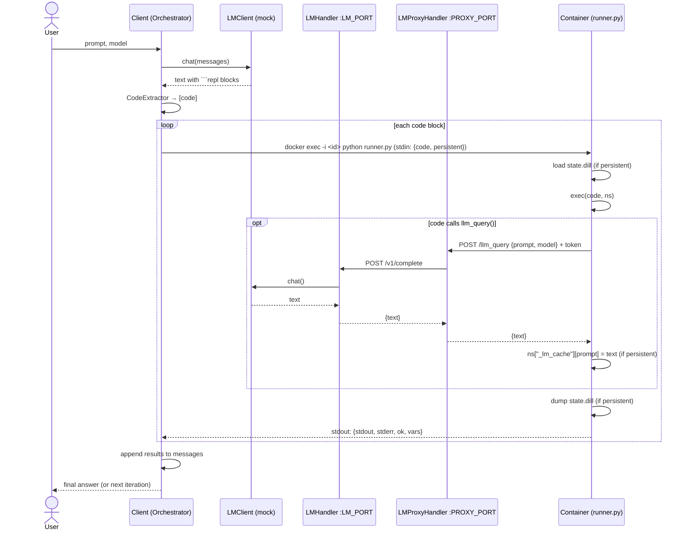

# DockerREPL — MVP Architecture

## 1. Goal

A client sends a prompt to a selected language model (LM). If the LM's reply
contains code blocks fenced as ```` ```repl ```` , the client extracts them and
runs them in a Docker container (`python:3.11-slim` + `dill` + `requests`) on
the same machine. Code running in the container may itself call the LM; those
calls go out over HTTP through an **LMProxyHandler** to the client's
**LMHandler** (a threading HTTP server). In **persistent** mode the container
keeps its variables, including saved LM responses, from one round to the next.

All components are Python. Code reaches the container through `docker exec`.
Calls from the container back to the LM use HTTP + JSON.

## 2. Component diagram

```
 ┌──────────────────────────────── HOST MACHINE ─────────────────────────────────┐
 │                                                                                │
 │  ┌──────────────────────────── Client process ───────────────────────────┐    │
 │  │                                                                        │    │
 │  │   User ──prompt──▶ ┌───────────────┐   chat()   ┌──────────────────┐   │    │
 │  │                    │  Orchestrator │──────────▶ │ LMClient (iface) │   │    │
 │  │   ◀──final answer──│  (Client)     │◀────────── │  └ MockLMClient  │   │    │
 │  │                    └──────┬────────┘   text     │  └ (OpenAI/…)    │   │    │
 │  │                           │                     └────────▲─────────┘   │    │
 │  │              text         ▼                              │ chat()      │    │
 │  │                    ┌───────────────┐            ┌────────┴─────────┐   │    │
 │  │                    │ CodeExtractor │            │    LMHandler     │   │    │
 │  │                    │ (```repl …```)│            │ ThreadingHTTP-   │   │    │
 │  │                    └──────┬────────┘            │ Server (thread)  │   │    │
 │  │                 [code str]│                     │ 127.0.0.1:LM_PORT│   │    │
 │  │                           ▼                     └────────▲─────────┘   │    │
 │  │             ┌──────────────────────────┐                 │             │    │
 │  │             │ with ContainerManager()  │                 │ HTTP POST   │    │
 │  │             │   as cm:  (cm.container_id)                │ /v1/complete│    │
 │  │             │   cm.execute(code_str)   │        ┌────────┴─────────┐   │    │
 │  │             └────────────┬─────────────┘        │  LMProxyHandler  │   │    │
 │  │                          │                      │ ThreadingHTTP-   │   │    │
 │  │                          │                      │ Server (thread)  │   │    │
 │  │                          │                      │ 0.0.0.0:PROXY_PORT   │    │
 │  │                          │                      └────────▲─────────┘   │    │
 │  └──────────────────────────┼───────────────────────────────┼─────────────┘    │
 │   docker exec -i <id>       │                               │ HTTP POST        │
 │     python /app/runner.py   │ stdin: {code, persistent}     │ /llm_query       │
 │                             │ stdout: {stdout, stderr, ok}  │ host.docker.internal
 │                             ▼                               │                  │
 │  ┌──────────── Docker container (python:3.11-slim, dill, requests) ──────────┐ │
 │  │   PID 1: sleep infinity       (one short-lived python per docker exec)    │ │
 │  │                    ┌───────────────┐   exec(code, ns)  ┌───────────────┐   │ │
 │  │                    │  runner.py    │──────────────────▶│ user code     │   │ │
 │  │                    │               │◀──captured out────│ llm_query(...)│───┘ │
 │  │                    └──────┬────────┘                   └───────────────┘     │
 │  │                           │ persistent? dill.load before / dill.dump after  │
 │  │                           ▼                                                 │
 │  │                 /workspace/state.dill  (volume)                             │
 │  └─────────────────────────────────────────────────────────────────────────────┘
 └────────────────────────────────────────────────────────────────────────────────┘
```

## 3. Components

| Component | Runs in | Responsibility |
|---|---|---|
| **Orchestrator (Client)** | host | Owns the session loop: prompt → LM → extract → execute → feed results back → repeat until a final answer or `max_iterations`. Starts/stops the two HTTP servers. Opens the container with `with ContainerManager(...) as cm:`. |
| **LMClient** | host | Abstract `chat(messages, model) -> str`. `MockLMClient` returns scripted/templated replies (including ```` ```repl ```` blocks) so the MVP costs no tokens. Real clients can be added later. |
| **CodeExtractor** | host | Regex over the LM text, returns `list[str]` of code blocks. Accepts ```` ```repl ```` (case-insensitive) and, optionally, `'''REPL ... '''`. |
| **LMHandler** | host, thread | `ThreadingHTTPServer` on `127.0.0.1:LM_PORT`. `POST /v1/complete` → calls `LMClient.chat` → returns JSON. Loopback only; never exposed to the container directly. |
| **LMProxyHandler** | host, thread | `ThreadingHTTPServer` reachable from the container (`host.docker.internal:PROXY_PORT`). Validates a per-session token, enforces limits (max calls, max prompt size, timeout), logs, then forwards to LMHandler. The single egress point from the sandbox to the LM. |
| **ContainerManager** | host | Context manager. `__enter__`: `docker run -d` the image with `sleep infinity` as PID 1, stores `container_id`. `execute(code)`: `docker exec -i <id> timeout <t> python /app/runner.py`, sends the JSON request on stdin, parses the JSON result from stdout. `reset()`: deletes `state.dill`. `__exit__`: `docker rm -f <id>`, which runs even if the loop raises. |
| **runner.py** | container | Short-lived script, one process per `docker exec`. Reads `{code, persistent}` from stdin. Builds a namespace (loads `state.dill` if persistent) and adds `llm_query()` to it. Runs `exec(code, ns)` with stdout/stderr redirected to buffers. Saves the namespace with `dill.dump` if persistent. Prints one JSON result line. |
| **llm_query()** | container | Helper the user code calls: `requests.post(LM_PROXY_URL + "/llm_query", json=..., headers={"X-Session-Token": ...})`. In persistent mode it also writes each reply into `_lm_cache` in the namespace, so later rounds can reuse it. |

### ContainerManager sketch

```python
class ContainerManager:
    def __enter__(self):
        self.container_id = _docker(
            "run", "-d", "--rm",
            "--add-host=host.docker.internal:host-gateway",
            "-e", f"LM_PROXY_URL={self.proxy_url}",
            "-e", f"SESSION_TOKEN={self.token}",
            "-v", f"{self.workspace}:/workspace",
            "--memory", "512m", "--pids-limit", "128",
            self.image, "sleep", "infinity",
        ).strip()
        return self

    def execute(self, code: str, timeout: float = 30) -> ExecResult:
        req = json.dumps({"code": code, "persistent": self.persistent})
        proc = subprocess.run(
            ["docker", "exec", "-i", self.container_id,
             "timeout", str(int(timeout)), "python", "/app/runner.py"],
            input=req, capture_output=True, text=True, timeout=timeout + 5,
        )
        return ExecResult.from_runner(proc)   # parse last stdout line as JSON

    def __exit__(self, *exc):
        _docker("rm", "-f", self.container_id)
```

Notes:
* **Send the code on stdin**, not as `python -c code_str`. You avoid
  shell quoting problems, argument-length limits, and having the code show up
  in `ps`. It also lets the request carry flags such as `persistent`.
* **Wrap the command in `timeout`** inside the container. A host-side
  `subprocess` timeout kills only the `docker` CLI. The Python process inside
  the container would keep running.
* **Let runner.py own stdout.** User `print()` output is captured into a
  buffer, and the only thing written to the real stdout is the JSON result.
  That keeps the result easy to parse.

## 4. Why a proxy *and* a handler?

* **Isolation:** LMHandler stays on loopback and holds the API keys. The
  container can only reach the proxy, which exposes one narrow endpoint.
* **Policy:** budgets, recursion depth, rate limits and auth all live in one
  place (the proxy), so LMHandler stays a plain "call the model" service.
* **Swap-ability:** the LM side can move to another machine later without
  changing anything in the container.

## 5. Sequence (one round)



**Avoiding deadlock:** while `cm.execute()` blocks the orchestrator thread on
`docker exec`, the container calls back into the host. That is why LMHandler
and LMProxyHandler each run a `ThreadingHTTPServer` in its own daemon thread,
started before the container is used.

## 6. Interfaces

| Interface | Request | Response |
|---|---|---|
| `docker exec -i <id> python /app/runner.py` | stdin: `{"code": str, "persistent": bool}` | last stdout line: `{"ok": bool, "stdout": str, "stderr": str, "error": str\|null, "variables": [str], "duration_s": float}` |
| `POST /llm_query` (LMProxyHandler) | header `X-Session-Token`; `{"prompt": str, "model": str\|null}` | `{"ok": bool, "text": str, "error": str\|null}` |
| `POST /v1/complete` (LMHandler) | `{"messages": [{"role","content"}], "model": str}` | `{"ok": bool, "text": str, "usage": {...}}` |

## 7. Persistent vs. non-persistent

Every `docker exec` starts a new Python process, so nothing stays in memory
between rounds. In persistent mode, `state.dill` is the only thing that
carries variables from one round to the next.

| | Non-persistent | Persistent |
|---|---|---|
| Namespace per exec | new, empty | loaded from `state.dill`, saved back afterwards |
| `_lm_cache` | gone after the call | kept; `llm_query` can return a cached reply instead of calling the LM again |
| Things dill can't pickle (sockets, open files, threads) | n/a | skipped with a warning; not saved |

Costs of this choice: each round pays Python startup time (roughly 50–100 ms)
plus the time to load and save `state.dill`, and that grows with the state.
Both are fine for an MVP. If they become a problem, swap `runner.py` for a
long-running exec server inside the container. Only `ContainerManager.execute`
would change.

## 8. Networking notes (Linux)

* Start the container with `--add-host=host.docker.internal:host-gateway` so it
  can reach the host. The proxy must bind to `0.0.0.0` (or the `docker0` IP),
  not `127.0.0.1`.
* No container ports are published. `docker exec` goes through the Docker
  daemon socket.
* Set `--memory`, `--cpus` and `--pids-limit`, and wrap each run in
  `timeout`, to contain runaway code.

## 9. Proposed layout

```
dockerrepl/
  client.py            # Orchestrator: session loop, wiring
  extractor.py         # CodeExtractor
  protocol.py          # dataclasses for the JSON messages above
  lm/
    base.py            # LMClient interface
    mock.py            # MockLMClient (scripted replies)
  servers/
    lm_handler.py      # LMHandler (ThreadingHTTPServer)
    lm_proxy.py        # LMProxyHandler (ThreadingHTTPServer)
  container/
    manager.py         # ContainerManager (context manager: run / exec / rm)
    Dockerfile         # python:3.11-slim + dill + requests + runner.py
    runner.py          # per-exec script + llm_query helper (copied into image)
tests/
  test_extractor.py
  test_servers.py      # handler/proxy without Docker
  test_runner.py       # runner.py as a local subprocess (no Docker)
  test_e2e.py          # full loop with MockLMClient (needs Docker)
```

## 10. MVP build order

1. `CodeExtractor` + `MockLMClient`, with unit tests.
2. `LMHandler` and `LMProxyHandler`, tested with `requests` on loopback.
3. `runner.py`, run as a local subprocess first (no Docker), persistent and
   non-persistent.
4. `Dockerfile` + `ContainerManager`; check that `llm_query` reaches the host.
5. Orchestrator loop + end-to-end test.
