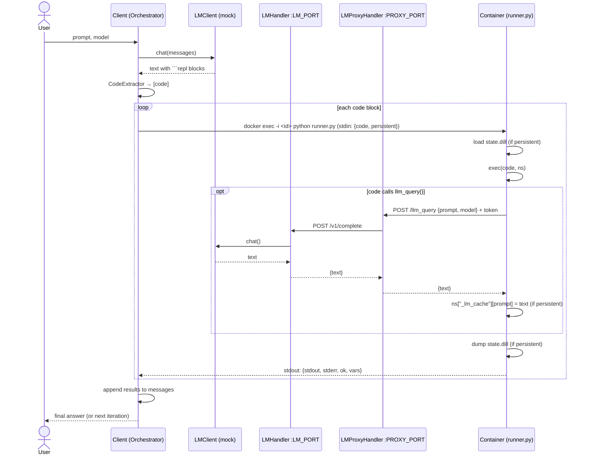

# DockerREPL — MVP Architecture

## 1. Goal

A client sends a prompt to a selected language model (LM), mocked for now. If
the LM's reply contains ```` ```repl ```` code blocks, the client extracts them
and runs them in a Docker container (`python:3.11-slim`, with `dill` and
`requests` installed). Code in the container can call the LM through
`llm_query()` and `llm_query_batched()`, and can call `SHOW_VARS()` to list
the variables the REPL currently holds. Those calls go over HTTP to an
**LMProxyHandler** on the host. The proxy forwards them to the **LMHandler**,
a multithreaded TCP server, using length-prefixed JSON. The client can also
give the container `custom_tools`. In **persistent** mode the container and
its variables, including saved LM responses, carry over from one prompt to
the next.

### Terms

| Term | Meaning |
|---|---|
| **session** | The lifetime of one container, together with its proxy and `state.dill`. |
| **round** | One `Client.completion(prompt)` call. Each round gets a **new LMHandler**. |
| **iteration** | One LM reply inside a round, plus running its code blocks. A round has at most `max_iterations` iterations. |

## 2. Component diagram

```
 ┌─────────────────────────────────── HOST ───────────────────────────────────────┐
 │  Client process                                                                │
 │                                                                                │
 │  User ─prompt─▶ ┌──────────────┐ completion(messages)  ┌────────────────────┐  │
 │                 │    Client    │──────── direct call ─▶│ LMHandler          │  │
 │  ◀─final answer─│ (round loop) │◀──────── text ────────│ ThreadingTCPServer │  │
 │                 └──┬────────┬──┘                       │ 127.0.0.1:<port 0> │  │
 │     find_code_blocks│        │ new LMHandler per round  │  └ MockLM          │  │
 │                    ▼        ▼ update_handler_address() └─────────▲──────────┘  │
 │      ┌──────────────────────────────────────────┐                │             │
 │      │ ContainerManager  (context manager)      │                │ TCP: 4-byte │
 │      │  container_id, persistent, custom_tools  │                │ big-endian  │
 │      │  execute_code(code) -> REPLResult        │                │ len + JSON  │
 │      │  ┌──────────────────────────────────────┐│                │ (new conn   │
 │      │  │ LMProxyServer  ThreadingHTTPServer   ││────────────────┘  per call)  │
 │      │  │ 0.0.0.0:<port 0>  handler class =    ││                              │
 │      │  │ LMProxyHandler; reads                ││                              │
 │      │  │ server.lm_handler_address (live)     ││                              │
 │      │  └──────────────────▲───────────────────┘│                              │
 │      └───────┬─────────────┼────────────────────┘                              │
 │  docker exec │ <id> python │ HTTP POST /llm_query, /llm_query_batched          │
 │  _exec.py    │ stdout: JSON│ via host.docker.internal:<proxy_port>             │
 │              ▼             │                                                   │
 │  ┌──────── container python:3.11-slim (+dill, requests) ─────────────────────┐ │
 │  │  PID 1: tail -f /dev/null                                                 │ │
 │  │  /workspace/_exec.py     rebuilt by the host for every code block,        │ │
 │  │     code str base64-embedded; one short-lived python process per exec     │ │
 │  │     load state.dill → add helpers (§3.5), answer, custom tools            │ │
 │  │     → exec(code) → save state.dill → print one JSON line                  │ │
 │  │  /workspace/state.dill   variables (bind mount from a host temp dir)      │ │
 │  └───────────────────────────────────────────────────────────────────────────┘ │
 └────────────────────────────────────────────────────────────────────────────────┘
```

The four links:

| Link | Transport | Why |
|---|---|---|
| Client → LMHandler | direct method call, same process | `lm_handler.completion(messages)`. The Client doesn't need a socket to reach its own handler. |
| Client → container | `execute_code(code: str)` → host writes `_exec.py` to the shared workspace → `docker exec <id> python /workspace/_exec.py` → JSON on stdout | The ContainerManager holds `container_id`. No port is published on the container. |
| container → LMProxyHandler | HTTP + JSON | The container can only use `requests`. The proxy is reached at `host.docker.internal`. |
| LMProxyHandler → LMHandler | TCP, 4-byte big-endian length + UTF-8 JSON | Simple framing, no HTTP overhead. LMHandler stays on loopback. |

## 3. Components and their parameters

Only the parameters listed here are in the MVP.

### 3.1 `comms.py`

```python
@dataclass
class LMRequest:            # proxy → handler
    prompt: str | list[dict] | None = None     # single
    prompts: list[str] | None = None           # batched
    model: str | None = None

@dataclass
class LMResponse:           # handler → proxy
    error: str | None = None
    response: str | None = None                # single
    responses: list[str | None] | None = None  # batched, same order as prompts
    errors: list[str | None] | None = None     # batched, per-prompt error or None

def socket_send(sock, data: dict) -> None:     # struct.pack(">I", len(b)) + b
def socket_recv(sock) -> dict:                 # read 4 bytes, then loop until len bytes
def socket_request(addr, data, timeout=300) -> dict   # new connection per request
def send_lm_request(addr, req) -> LMResponse
def send_lm_request_batched(addr, prompts, model=None) -> LMResponse
```

`socket_recv` has to loop until it has read all `length` bytes, because
`recv` can return fewer bytes than asked for. If the connection closes partway
through a message, it raises `ConnectionError`.

### 3.2 `LMHandler`

```python
class LMHandler:
    def __init__(self, client: BaseLM, host="127.0.0.1", port=0,
                 batch_max_concurrent: int = 8): ...
    address: tuple[str, int]        # real port, read after start()
    def start(self) -> tuple[str, int]
    def stop(self) -> None
    def completion(self, prompt, model=None) -> str   # direct call used by Client
    __enter__ / __exit__            # start / stop
```

* The server is `ThreadingTCPServer` with `daemon_threads = True` and
  `allow_reuse_address = True`. Its request handler is a
  `StreamRequestHandler` that does `socket_recv`, then dispatches, then
  `socket_send`. Each connection gets its own thread.
* `serve_forever()` runs in a daemon `Thread`.
* `port=0` lets the OS pick a free port, so a new handler for each round never
  clashes with an earlier one.
* **Batched requests:** one request carries all the prompts. The handler runs
  them concurrently with a `ThreadPoolExecutor(max_workers=batch_max_concurrent)`,
  keeps the input order, and records a failure for one prompt without failing
  the others. Threads fit a synchronous `completion()`; an async client
  could use `asyncio.gather` instead.

### 3.3 `BaseLM` / `MockLM`

```python
class BaseLM(ABC):
    model_name: str
    @abstractmethod
    def completion(self, prompt: str | list[dict]) -> str: ...

class MockLM(BaseLM):
    def __init__(self, scripted: list[str] | None = None, model_name="mock"): ...
```

* **Root prompts** (a list of messages from the Client) get the next reply from
  `scripted`, which can contain ```` ```repl ```` blocks. When the list runs
  out, MockLM returns a fixed final-answer block. The position in the list is
  guarded by a lock.
* **Sub-queries** (a `str` from `llm_query`) get `f"Mock: {prompt[:50]}"`.
* **No token cost.** A real client only needs to implement `completion()`.

### 3.4 `ContainerManager` + `LMProxyHandler`

```python
class ContainerManager:
    def __init__(self,
                 image: str = "python:3.11-slim",
                 lm_handler_address: tuple[str, int] | None = None,
                 persistent: bool = False,
                 custom_tools: dict[str, Any] | None = None,
                 exec_timeout: int = 60): ...
    container_id: str
    proxy_port: int
    def setup(self) -> None                       # called by __init__
    def execute_code(self, code: str) -> REPLResult
    def update_handler_address(self, addr) -> None
    def cleanup(self) -> None                     # idempotent
    __enter__ / __exit__                          # __exit__ → cleanup()
```

**`setup()`** does the following in order:
1. Calls `validate_custom_tools()`.
2. Makes a host temp dir to use as the workspace.
3. Starts `LMProxyServer = ThreadingHTTPServer(("0.0.0.0", 0), LMProxyHandler)`
   with `daemon_threads = True`, and sets
   `server.lm_handler_address = lm_handler_address`.
4. Runs `docker run -d --rm -v <tmp>:/workspace --add-host host.docker.internal:host-gateway <image> tail -f /dev/null`
   and saves the `container_id` it prints.
5. Runs `docker exec <id> pip install -q dill requests` (the default install),
   then checks that `import requests` works.

**`execute_code(code: str)`** takes the code block exactly as the LM wrote
it, as found by `find_code_blocks`. It:
1. Builds a complete script with `_build_exec_script(code, proxy_port, custom_tools)`
   (§3.5). The code is embedded **base64-encoded**, so quotes, backslashes and
   triple quotes in LM-written code can't break the script.
2. Writes that script to `<tmp>/_exec.py`, which the container sees as
   `/workspace/_exec.py`.
3. Runs `docker exec <id> timeout <exec_timeout> python /workspace/_exec.py`.
4. Parses the last line of stdout as JSON and returns:

```python
@dataclass
class REPLResult:
    stdout: str
    stderr: str
    locals: dict[str, str]        # name -> repr(value)
    final_answer: str | None      # set when the code sets answer["ready"] = True
    execution_time: float
```

**`update_handler_address(addr)`** sets `proxy_server.lm_handler_address = addr`.
It also runs `answer = {"content": "", "ready": False}` in the container, so
an old `ready=True` from the previous round doesn't end the new round at
once. The container never sees the change of address.

**`LMProxyHandler(BaseHTTPRequestHandler)`** has two routes, and every reply is
JSON. Each route reads `self.server.lm_handler_address` on every request,
which is what lets the address change from round to round.
* `POST /llm_query` with `{"prompt", "model"}` makes one framed TCP request to
  LMHandler and returns `{"response"}` or `{"error"}`.
* `POST /llm_query_batched` with `{"prompts", "model"}` makes one framed TCP
  request carrying all the prompts and returns `{"responses": [...]}`. A
  failed prompt comes back as `"Error: ..."` in its place in the list.

It returns `{"error": "No LM handler configured"}` if no address is set, and
`500 {"error"}` if the handler itself raises. It never drops a connection
without replying.

**`custom_tools`** format:

```python
custom_tools = {
    "triple": "def triple(x):\n    return x * 3",               # code string → exec'd
    "CONST":  7,                                                # JSON value → variable
    "LOOKUP": {"tool": {"a": 1}, "description": "a dict"},      # value + description
}
```

* **Code strings** (starting with `def`, `class` or `lambda`, or containing a
  newline) are run with `exec()` in the container's namespace.
* **JSON-serializable values** are loaded as variables.
* **Host callables are rejected with `ValueError`.** A Python function can't
  cross into the container, so pass it as a code string instead. Failing
  early makes the mistake obvious.
* **Reserved names** can't be used: `llm_query`, `llm_query_batched`,
  `SHOW_VARS` and `answer`.
* **Tools are put into every generated script** by `_build_custom_tools_code()`,
  so user code that overwrites one doesn't break later runs.
* **Descriptions go into the system prompt** through `format_tools_for_prompt()`.

### 3.5 `_build_exec_script()` → `_exec.py` (one process per exec)

On the host, `_build_exec_script(code, proxy_port, custom_tools) -> str`
fills in a template. The generated `_exec.py` then runs in the container:

```python
PROXY = "http://host.docker.internal:<proxy_port>"          # filled in by the host
def llm_query(prompt, model=None) -> str                    # POST /llm_query
def llm_query_batched(prompts, model=None) -> list[str]     # POST /llm_query_batched
def SHOW_VARS() -> str                                      # list REPL variables, no network
# custom tools: code strings pasted in, JSON values loaded with json.loads
code = base64.b64decode("<code_b64>").decode()
```

* `llm_query` and `llm_query_batched` return `"Error: ..."` strings instead of
  raising, so a failed LM call doesn't crash the user's code.
* `SHOW_VARS()` returns `"Available variables: {name: type_name, ...}"` for
  every variable whose name doesn't start with `_`, leaving out `answer`. If
  there are none, it says so. The LM can use it to look inside the container
  before writing more code, for example `print(SHOW_VARS())`. It runs entirely
  inside the container and makes no LM call.
* Steps for each exec:
  1. Decode `code` from base64.
  2. Load `state.dill`. If there is no `answer`, set
     `answer = {"content": "", "ready": False}`.
  3. Build the namespace from the helpers plus the custom tools.
  4. `exec(code)`, with stdout and stderr captured to buffers.
  5. Save every variable that dill can pickle and whose name doesn't start
     with `_`.
  6. Print one JSON line: `{stdout, stderr, locals, final_answer}`.
* **Saved LM responses** are just variables. For example, `r = llm_query(...)`
  is still there in the next exec, and in the next round if `persistent=True`.

### 3.6 `Client`

```python
class Client:
    def __init__(self, lm: BaseLM,
                 persistent: bool = False,
                 custom_tools: dict[str, Any] | None = None,
                 max_iterations: int = 10,
                 image: str = "python:3.11-slim"): ...
    def completion(self, prompt: str) -> str        # one round
    def close(self) -> None                         # cleans up a persistent container
    __enter__ / __exit__
```

```python
def completion(self, prompt):
    with LMHandler(self.lm) as lm_handler:                     # new handler per round
        if self.persistent and self._env is not None:
            env = self._env
            env.update_handler_address(lm_handler.address)
        else:
            env = ContainerManager(self.image, lm_handler.address,
                                   self.persistent, self.custom_tools)
            if self.persistent: self._env = env
        try:
            messages = build_system_prompt(self.custom_tools) + [user(prompt)]
            for _ in range(self.max_iterations):
                reply = lm_handler.completion(messages)
                messages.append(assistant(reply))
                for code in find_code_blocks(reply):            # r"```repl\s*\n(.*?)\n```"
                    result = env.execute_code(code)
                    if result.final_answer is not None:
                        return result.final_answer
                    messages.append(user(format_result(code, result)))
            return lm_handler.completion(messages + [ask_for_final_answer()])
        finally:
            if not self.persistent: env.cleanup()
```

`build_system_prompt()` tells the LM to write ```` ```repl ```` blocks, lists
`llm_query`, `llm_query_batched` and `SHOW_VARS`, explains `answer["ready"]`,
and adds the custom tool descriptions.

The LMHandler stops when its `with` block ends. The container and proxy stay
up if `persistent=True`.

## 4. Sequence (one round)

```mermaid
sequenceDiagram
    actor U as User
    participant C as Client
    participant H as LMHandler (TCP, new each round)
    participant M as ContainerManager
    participant P as LMProxyHandler (HTTP)
    participant X as Container (_exec.py)

    U->>C: completion(prompt)
    C->>H: start() on port 0 → (127.0.0.1, port)
    alt persistent and container exists
        C->>M: update_handler_address((host, port))
        M->>P: server.lm_handler_address = (host, port)
    else
        C->>M: ContainerManager(lm_handler_address, persistent, custom_tools)
        M->>P: start ThreadingHTTPServer 0.0.0.0:0
        M->>X: docker run … tail -f /dev/null; pip install dill requests
    end
    loop iteration ≤ max_iterations
        C->>H: completion(messages) (direct call)
        H-->>C: reply with ```repl blocks
        loop each code block
            C->>M: execute_code(code)
            M->>M: _build_exec_script(code) → write /workspace/_exec.py
            M->>X: docker exec <id> python /workspace/_exec.py
            opt llm_query / llm_query_batched
                X->>P: HTTP POST /llm_query[_batched]
                P->>H: TCP [len][JSON LMRequest]
                H-->>P: TCP [len][JSON LMResponse] (batched: thread pool)
                P-->>X: HTTP 200 {response | responses}
            end
            X-->>M: stdout JSON {stdout, stderr, locals, final_answer}
            M-->>C: REPLResult
        end
    end
    C->>H: stop()
    opt not persistent
        C->>M: cleanup() → docker rm -f, proxy shutdown, rm temp dir
    end
    C-->>U: final answer
```

## 5. Persistent vs. non-persistent

**Within one round, variables always carry
over** between code blocks and iterations through `state.dill`, because a
multi-step answer depends on that. The `persistent` flag only decides whether
the session lasts beyond the round.

| | `persistent=False` | `persistent=True` |
|---|---|---|
| Container + proxy | made at the start of the round, removed at the end | made once, reused until `Client.close()` |
| LMHandler | new each round | new each round; `update_handler_address()` points the proxy at it |
| Variables / saved LM responses | gone after the round | carried into later rounds |
| `answer` | starts fresh | reset by `update_handler_address()` |

## 6. Threading and concurrency

* **Both servers are multithreaded.** LMHandler is a `ThreadingTCPServer` and
  LMProxyServer is a `ThreadingHTTPServer`. Each one runs `serve_forever()` in
  a daemon thread, handles every connection in its own thread, and sets
  `daemon_threads = True`.
* **No deadlock.** The Client's main thread waits on `docker exec` while the
  container calls back into both servers, and those run on their own threads.
* **Concurrency in two places.** User code can run `llm_query` from several
  threads at once, and each call gets its own proxy and handler threads. A
  single `llm_query_batched` call fans out inside LMHandler through its thread
  pool.
* **No late requests.** Shutting down the old LMHandler at the end of a round
  is safe. `docker exec` only returns once the `_exec.py` process has exited, so
  no `llm_query` from that round can still be in flight.
* **Shared state:** the MockLM position in its script uses a lock, and the
  proxy shares no `requests.Session`.

## 7. Networking (Linux)

* **The proxy binds to `0.0.0.0`.** On native Linux, `host.docker.internal`
  (set by `--add-host … host-gateway`) points to the bridge gateway, such as
  `172.17.0.1`. A server bound to `127.0.0.1` can't be reached from there.
* **LMHandler binds to `127.0.0.1`.** Only the proxy, on the same host, talks
  to it.
* **No container ports are published.** All code execution goes through
  `docker exec`.

## 8. Layout

```
dockerrepl/
  comms.py               # LMRequest/LMResponse, socket_send/recv/request, send_lm_request[_batched]
  lm_handler.py          # LMHandler (ThreadingTCPServer)
  clients/
    base_lm.py           # BaseLM
    mock_lm.py           # MockLM
  environments/
    tools.py             # validate_custom_tools, format_tools_for_prompt, RESERVED_TOOL_NAMES
    container_manager.py # ContainerManager, LMProxyHandler, REPLResult
    exec_script.py       # _build_exec_script, _build_custom_tools_code (template for _exec.py)
  client.py              # Client, find_code_blocks, prompt helpers
examples/
  docker_repl_example.py # exec, llm_query, llm_query_batched, SHOW_VARS, tools, persistent
tests/
  test_comms.py          # framing round-trip, partial reads, closed connection
  test_lm_handler.py     # single + batched over real sockets, no Docker
  test_proxy.py          # proxy ↔ handler over loopback, no Docker
  test_exec_script.py    # generated _exec.py run as a local subprocess, no Docker
  test_e2e.py            # Client + MockLM + Docker (skipped if Docker is missing)
```

## 9. Scope

In the MVP:
* one LM client (`MockLM`), a new LMHandler for each round
* `llm_query`, `llm_query_batched`, `SHOW_VARS`, `custom_tools`,
  `answer["ready"]`
* persistent and non-persistent sessions, a time limit on each exec

Left out for now:
* recursive sub-calls (an LM call that starts its own REPL loop)
* several LM backends and routing between them
* versioned context/history variables across rounds, and history compaction
* usage, token and budget tracking; structured logging

## 10. Build order

1. `comms.py` and its tests.
2. `BaseLM`, `MockLM` and `LMHandler`, tested over sockets.
3. `LMProxyHandler` and `tools.py`, tested against a real LMHandler with no
   Docker.
4. `exec_script.py`: build a script and run it locally as a subprocess,
   pointed at a local proxy.
5. `ContainerManager`, checked with Docker.
6. `Client` and `examples/docker_repl_example.py`, then the end-to-end test.
 ┌──────────────────────────────── HOST MACHINE ─────────────────────────────────┐
 │                                                                                │
 │  ┌──────────────────────────── Client process ───────────────────────────┐    │
 │  │                                                                        │    │
 │  │   User ──prompt──▶ ┌───────────────┐   chat()   ┌──────────────────┐   │    │
 │  │                    │  Orchestrator │──────────▶ │ LMClient (iface) │   │    │
 │  │   ◀──final answer──│  (Client)     │◀────────── │  └ MockLMClient  │   │    │
 │  │                    └──────┬────────┘   text     │  └ (OpenAI/…)    │   │    │
 │  │                           │                     └────────▲─────────┘   │    │
 │  │              text         ▼                              │ chat()      │    │
 │  │                    ┌───────────────┐            ┌────────┴─────────┐   │    │
 │  │                    │ CodeExtractor │            │    LMHandler     │   │    │
 │  │                    │ (```repl …```)│            │ ThreadingHTTP-   │   │    │
 │  │                    └──────┬────────┘            │ Server (thread)  │   │    │
 │  │                 [code str]│                     │ 127.0.0.1:LM_PORT│   │    │
 │  │                           ▼                     └────────▲─────────┘   │    │
 │  │             ┌──────────────────────────┐                 │             │    │
 │  │             │ with ContainerManager()  │                 │ HTTP POST   │    │
 │  │             │   as cm:  (cm.container_id)                │ /v1/complete│    │
 │  │             │   cm.execute(code_str)   │        ┌────────┴─────────┐   │    │
 │  │             └────────────┬─────────────┘        │  LMProxyHandler  │   │    │
 │  │                          │                      │ ThreadingHTTP-   │   │    │
 │  │                          │                      │ Server (thread)  │   │    │
 │  │                          │                      │ 0.0.0.0:PROXY_PORT   │    │
 │  │                          │                      └────────▲─────────┘   │    │
 │  └──────────────────────────┼───────────────────────────────┼─────────────┘    │
 │   docker exec -i <id>       │                               │ HTTP POST        │
 │     python /app/runner.py   │ stdin: {code, persistent}     │ /llm_query       │
 │                             │ stdout: {stdout, stderr, ok}  │ host.docker.internal
 │                             ▼                               │                  │
 │  ┌──────────── Docker container (python:3.11-slim, dill, requests) ──────────┐ │
 │  │   PID 1: sleep infinity       (one short-lived python per docker exec)    │ │
 │  │                    ┌───────────────┐   exec(code, ns)  ┌───────────────┐   │ │
 │  │                    │  runner.py    │──────────────────▶│ user code     │   │ │
 │  │                    │               │◀──captured out────│ llm_query(...)│───┘ │
 │  │                    └──────┬────────┘                   └───────────────┘     │
 │  │                           │ persistent? dill.load before / dill.dump after  │
 │  │                           ▼                                                 │
 │  │                 /workspace/state.dill  (volume)                             │
 │  └─────────────────────────────────────────────────────────────────────────────┘
 └────────────────────────────────────────────────────────────────────────────────┘
```

## 3. Components

| Component | Runs in | Responsibility |
|---|---|---|
| **Orchestrator (Client)** | host | Owns the session loop: prompt → LM → extract → execute → feed results back → repeat until a final answer or `max_iterations`. Starts/stops the two HTTP servers. Opens the container with `with ContainerManager(...) as cm:`. |
| **LMClient** | host | Abstract `chat(messages, model) -> str`. `MockLMClient` returns scripted/templated replies (including ```` ```repl ```` blocks) so the MVP costs no tokens. Real clients can be added later. |
| **CodeExtractor** | host | Regex over the LM text, returns `list[str]` of code blocks. Accepts ```` ```repl ```` (case-insensitive) and, optionally, `'''REPL ... '''`. |
| **LMHandler** | host, thread | `ThreadingHTTPServer` on `127.0.0.1:LM_PORT`. `POST /v1/complete` → calls `LMClient.chat` → returns JSON. Loopback only; never exposed to the container directly. |
| **LMProxyHandler** (served by LMProxyServer) | host, thread | `ThreadingHTTPServer` reachable from the container (`host.docker.internal:PROXY_PORT`). Validates a per-session token, enforces limits (max calls, max prompt size, timeout), logs, then forwards to LMHandler. The single egress point from the sandbox to the LM. |
| **ContainerManager** | host | Context manager. `__enter__`: `docker run -d` the image with `sleep infinity` as PID 1, stores `container_id`. `execute(code)`: `docker exec -i <id> timeout <t> python /app/runner.py`, sends the JSON request on stdin, parses the JSON result from stdout. `reset()`: deletes `state.dill`. `__exit__`: `docker rm -f <id>`, which runs even if the loop raises. |
| **runner.py** | container | Short-lived script, one process per `docker exec`. Reads `{code, persistent}` from stdin. Builds a namespace (loads `state.dill` if persistent) and adds `llm_query()` to it. Runs `exec(code, ns)` with stdout/stderr redirected to buffers. Saves the namespace with `dill.dump` if persistent. Prints one JSON result line. |
| **llm_query()** | container | Helper the user code calls: `requests.post(LM_PROXY_URL + "/llm_query", json=..., headers={"X-Session-Token": ...})`. In persistent mode it also writes each reply into `_lm_cache` in the namespace, so later rounds can reuse it. |

### ContainerManager sketch

```python
class ContainerManager:
    def __enter__(self):
        self.container_id = _docker(
            "run", "-d", "--rm",
            "--add-host=host.docker.internal:host-gateway",
            "-e", f"LM_PROXY_URL={self.proxy_url}",
            "-e", f"SESSION_TOKEN={self.token}",
            "-v", f"{self.workspace}:/workspace",
            "--memory", "512m", "--pids-limit", "128",
            self.image, "sleep", "infinity",
        ).strip()
        return self

    def execute(self, code: str, timeout: float = 30) -> ExecResult:
        req = json.dumps({"code": code, "persistent": self.persistent})
        proc = subprocess.run(
            ["docker", "exec", "-i", self.container_id,
             "timeout", str(int(timeout)), "python", "/app/runner.py"],
            input=req, capture_output=True, text=True, timeout=timeout + 5,
        )
        return ExecResult.from_runner(proc)   # parse last stdout line as JSON

    def __exit__(self, *exc):
        _docker("rm", "-f", self.container_id)
```

Notes:
* **Send the code on stdin**, not as `python -c code_str`. You avoid
  shell quoting problems, argument-length limits, and having the code show up
  in `ps`. It also lets the request carry flags such as `persistent`.
* **Wrap the command in `timeout`** inside the container. A host-side
  `subprocess` timeout kills only the `docker` CLI. The Python process inside
  the container would keep running.
* **Let runner.py own stdout.** User `print()` output is captured into a
  buffer, and the only thing written to the real stdout is the JSON result.
  That keeps the result easy to parse.

## 4. Why a proxy *and* a handler?

* **Isolation:** LMHandler stays on loopback and holds the API keys. The
  container can only reach the proxy, which exposes one narrow endpoint.
* **Policy:** budgets, recursion depth, rate limits and auth all live in one
  place (the proxy), so LMHandler stays a plain "call the model" service.
* **Swap-ability:** the LM side can move to another machine later without
  changing anything in the container.

## 5. Sequence (one round)



**Avoiding deadlock:** while `cm.execute()` blocks the orchestrator thread on
`docker exec`, the container calls back into the host. That is why LMHandler
and LMProxyHandler each run a `ThreadingHTTPServer` in its own daemon thread,
started before the container is used.

### Threading model

Both servers are multithreaded at two levels:

1. **One background thread per server.** Each server's `serve_forever()` runs
   in its own daemon thread, started by the Orchestrator before the container
   is used. The Orchestrator's main thread is then free to block on
   `docker exec`.
2. **One thread per request.** `ThreadingHTTPServer` (stdlib `http.server`)
   handles each incoming request in a new thread. Set `daemon_threads = True`
   so shutdown doesn't hang. Several `llm_query()` calls can then be in flight
   at once, for example when user code fans out with a `ThreadPoolExecutor`.
   A slow LM call doesn't hold up the others.

```python
class LMServer:                                # same pattern for LMProxyServer
    def __init__(self, host, port, handler_cls, **ctx):
        self.httpd = ThreadingHTTPServer((host, port), handler_cls)
        self.httpd.daemon_threads = True
        self.httpd.ctx = ctx                    # handlers read self.server.ctx
        self._thread = threading.Thread(target=self.httpd.serve_forever, daemon=True)

    def __enter__(self):
        self._thread.start(); return self

    def __exit__(self, *exc):
        self.httpd.shutdown(); self.httpd.server_close(); self._thread.join()
```

Startup order: start LMHandler, then LMProxyServer, then open the
`ContainerManager`. Shut down in the reverse order, which nested `with`
blocks do for you.

Thread-safety rules, because handlers run at the same time:
* **Shared mutable state needs a lock.** That includes the proxy's per-session
  call counter and budget, and any usage/log records LMHandler keeps.
* **The `LMClient` must be safe to call from several threads.** `MockLMClient`
  should keep no state, or guard its scripted-reply cursor with a lock.
* **Don't share one `requests.Session` across handler threads.** In the proxy,
  use a plain `requests.post` (or `urllib`) for each forwarded call.
* **Put a timeout on every hop.** container → proxy, proxy → handler, and
  handler → LM each need one, so a hung call can't hold a thread forever.

## 6. Interfaces

| Interface | Request | Response |
|---|---|---|
| `docker exec -i <id> python /app/runner.py` | stdin: `{"code": str, "persistent": bool}` | last stdout line: `{"ok": bool, "stdout": str, "stderr": str, "error": str\|null, "variables": [str], "duration_s": float}` |
| `POST /llm_query` (LMProxyHandler) | header `X-Session-Token`; `{"prompt": str, "model": str\|null}` | `{"ok": bool, "text": str, "error": str\|null}` |
| `POST /v1/complete` (LMHandler) | `{"messages": [{"role","content"}], "model": str}` | `{"ok": bool, "text": str, "usage": {...}}` |

## 7. Persistent vs. non-persistent

Every `docker exec` starts a new Python process, so nothing stays in memory
between rounds. In persistent mode, `state.dill` is the only thing that
carries variables from one round to the next.

| | Non-persistent | Persistent |
|---|---|---|
| Namespace per exec | new, empty | loaded from `state.dill`, saved back afterwards |
| `_lm_cache` | gone after the call | kept; `llm_query` can return a cached reply instead of calling the LM again |
| Things dill can't pickle (sockets, open files, threads) | n/a | skipped with a warning; not saved |

Costs of this choice: each round pays Python startup time (roughly 50–100 ms)
plus the time to load and save `state.dill`, and that grows with the state.
Both are fine for an MVP. If they become a problem, swap `runner.py` for a
long-running exec server inside the container. Only `ContainerManager.execute`
would change.

## 8. Networking notes (Linux)

* Start the container with `--add-host=host.docker.internal:host-gateway` so it
  can reach the host. The proxy must bind to `0.0.0.0` (or the `docker0` IP),
  not `127.0.0.1`.
* No container ports are published. `docker exec` goes through the Docker
  daemon socket.
* Set `--memory`, `--cpus` and `--pids-limit`, and wrap each run in
  `timeout`, to contain runaway code.

## 9. Proposed layout

```
dockerrepl/
  client.py            # Orchestrator: session loop, wiring
  extractor.py         # CodeExtractor
  protocol.py          # dataclasses for the JSON messages above
  lm/
    base.py            # LMClient interface
    mock.py            # MockLMClient (scripted replies)
  servers/
    lm_handler.py      # LMHandler (ThreadingHTTPServer)
    lm_proxy.py        # LMProxyHandler (ThreadingHTTPServer)
  container/
    manager.py         # ContainerManager (context manager: run / exec / rm)
    Dockerfile         # python:3.11-slim + dill + requests + runner.py
    runner.py          # per-exec script + llm_query helper (copied into image)
tests/
  test_extractor.py
  test_servers.py      # handler/proxy without Docker
  test_runner.py       # runner.py as a local subprocess (no Docker)
  test_e2e.py          # full loop with MockLMClient (needs Docker)
```

## 10. MVP build order

1. `CodeExtractor` + `MockLMClient`, with unit tests.
2. `LMHandler` and `LMProxyHandler`, tested with `requests` on loopback.
3. `runner.py`, run as a local subprocess first (no Docker), persistent and
   non-persistent.
4. `Dockerfile` + `ContainerManager`; check that `llm_query` reaches the host.
5. Orchestrator loop + end-to-end test.
